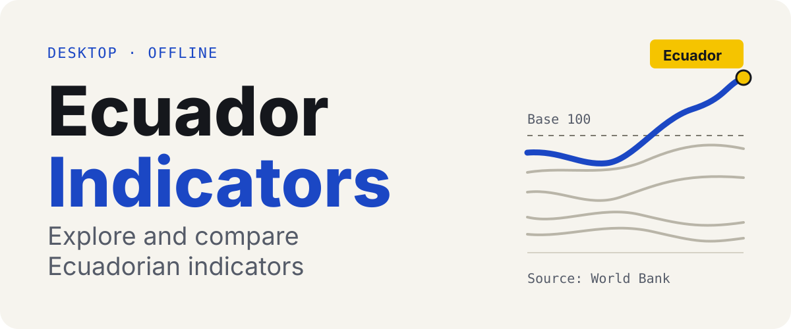
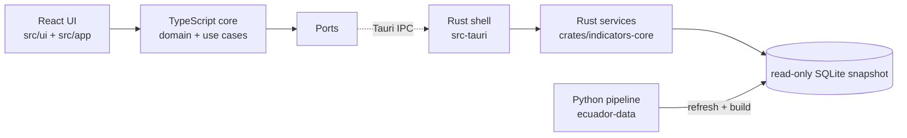

<p align="center">
  
</p>

<p align="center">
  Explore, compare and export Ecuadorian indicators from an offline World Bank snapshot.<br>
  [Español](README.md) · <b>English</b>
</p>

<p align="center">
  <a href="https://github.com/Eduardo12Pacheco/indicadores-ecuador-escritorio/actions/workflows/ci.yml"></a>
  <a href="https://github.com/Eduardo12Pacheco/indicadores-ecuador-escritorio/releases/latest"></a>
  <a href="LICENSE"></a>
</p>

<p align="center">
  
</p>

## What it is

Ecuador Indicators is a desktop app (Tauri 2, React and Rust) to explore and compare 38 World Development Indicators from the World Bank for Ecuador, Colombia, Peru, Chile, Bolivia, Latin America & the Caribbean and the World. It works without a browser, an API key or an internet connection.

- **Explore**: 38 indicators across 8 topics, with peers, year ranges, Level/YoY/Index transforms and an accessible data-table alternative.
- **Compare**: trajectories indexed to a base year, or a cross-country ranking with Ecuador highlighted.
- **Export**: CSV (RFC 4180) and 2× PNG with title, legend and attribution.
- **Accessible**: keyboard-first flows, WCAG 2.0/2.1 AA axe scans, light and dark themes, complete English and Spanish UI.

| Explore | Compare | Data & About |
|---|---|---|
|  |  |  |

## Why it is different

Ecuadorian statistics are spread across portals with different formats and licences. This app starts from a single reproducible artifact:

- **Verifiable snapshot**: the SQLite base is built from a raw cache with checksums; two builds from the same cache produce the same `logical_sha256`.
- **Attribution in every output**: WDI is CC BY 4.0 and every indicator credits its provider; the PNG export carries the attribution.
- **Checkable architecture**: a pure TypeScript domain, a thin Rust core and a Python pipeline that never enters the desktop runtime. Hexagonal rules are tested in all three languages.

## How it works



The UI never touches SQLite: it talks to Rust over typed IPC. To regenerate the snapshot from the World Bank:

```bash
cd pipeline && uv sync --frozen
uv run ecuador-data refresh   # network: World Bank API -> data/raw + MANIFEST.json
uv run ecuador-data build     # offline: raw cache -> schema-v1 snapshot
uv run ecuador-data verify    # checksums, counts, logical and file hashes
```

Schema, lineage and data limitations: [docs/DATA.md](docs/DATA.md). Full architecture: [docs/ARCHITECTURE.md](docs/ARCHITECTURE.md).

<details>
<summary>Tech stack</summary>

| Area | Choice |
|---|---|
| Desktop shell | Tauri 2 (Rust), NSIS/MSI, DMG, DEB/RPM/AppImage |
| UI | React 19, TypeScript 7, Vite 8, react-router 7, TanStack Query 5 |
| Charts | Apache ECharts 6, tree-shaken, accessible alternative table |
| Styling | CSS Modules + CSS custom-property tokens, Radix primitives, cmdk |
| Data pipeline | Python 3.12, uv, pydantic, httpx, Typer, SQLite, DuckDB (optional) |
| Tests | Vitest + Testing Library + fast-check, Playwright + axe, cargo test + proptest, pytest + Hypothesis |
| CI/CD | GitHub Actions on Linux, Windows and macOS; tag-driven releases |

</details>

## Quick start

Requirements: Node.js 24 or later (26 recommended), stable Rust 1.95 or later and [uv](https://docs.astral.sh/uv/) 0.11 or later. On Linux, install the Tauri packages listed in [CONTRIBUTING.md](CONTRIBUTING.md#requisitos-previos) first.

```bash
git clone https://github.com/Eduardo12Pacheco/indicadores-ecuador-escritorio.git
cd indicadores-ecuador-escritorio
npm ci
npm run tauri dev     # opens the app in development mode
npm run verify        # lint, types, tests, Rust, Python, data, build and E2E
```

On Windows, run the same commands in PowerShell.

There is no tagged release yet. When one exists, the installers are on the releases page with these names:

```bash
sudo apt install ./ecuador-indicators_0.1.0_linux_x64.deb  # Linux (Debian/Ubuntu)
open ecuador-indicators_0.1.0_macos_arm64.dmg               # macOS (Apple Silicon)
# Windows: run ecuador-indicators_0.1.0_windows_x64.exe
```

Other formats, checksums and `gh attestation verify` are in [docs/INSTALL.md](docs/INSTALL.md).

## Results

| Gate | Measured value |
|---|---|
| TypeScript coverage | 91.7% lines · 83.87% branches · 91.67% statements · 91.56% functions |
| Python pipeline coverage | 96.1% |
| Browser E2E | 68 scenarios (Chromium + WebKit projects) |
| Rust core line coverage | 88.9% measured in CI run 44749667530 (gate: 85%, `cargo llvm-cov`) |
| JavaScript gzip total | 392,397 B |
| Bundled snapshot | 38 indicators · 8 topics · 7 geographies · 11,780 observations |

`npm run metrics` prints every value above except the Rust figure, which comes
from `cargo llvm-cov -p indicators-core`. The gzip budget is 716,800 B and the
native E2E suite runs on Linux in CI.

## Honest limitations

- Annual World Bank data only; many series lag by years and some are modelled estimates, so the latest year can differ by indicator.
- Not an official BCE or INEC statistics product; those sources are documented as future adapters, not bundled.
- No tagged release exists yet, and installers are unsigned: SmartScreen and Gatekeeper require approval. Checksums and provenance attestations ship with every release.
- Native E2E covers Linux only (`tauri-driver` has no WKWebView driver); the same flows run in WebKit and Chromium in the browser suite.
- Screenshots use the full snapshot through the in-memory adapter.

## Documentation

[Architecture](docs/ARCHITECTURE.md) · [Configuration](docs/ARCHITECTURE.md#configuración) · [Data](docs/DATA.md) · [Design](docs/DESIGN.md) · [Testing](docs/TESTING.md) · [Installation](docs/INSTALL.md) · [Releasing](docs/RELEASING.md) · [Lakehouse](docs/LAKEHOUSE-MANIFEST.md) · [Contributing](CONTRIBUTING.md) · [Security](SECURITY.md) · [Notices](THIRD_PARTY_NOTICES.md)

## License

MIT © 2026 Eduardo Pacheco. Bundled World Bank data is CC BY 4.0; see [THIRD_PARTY_NOTICES.md](THIRD_PARTY_NOTICES.md).

## Author

Eduardo Pacheco · https://github.com/Eduardo12Pacheco
