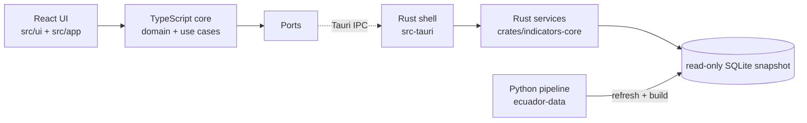

# Ecuador Indicators
[Español](README.md) · **English**

[](https://github.com/Eduardo12Pacheco/indicadores-ecuador-escritorio/actions/workflows/ci.yml)
[](https://github.com/Eduardo12Pacheco/indicadores-ecuador-escritorio/releases/latest)
[](LICENSE)
[](docs/INSTALL.md)

A polished, offline-first desktop app for exploring, comparing and exporting
Ecuadorian indicators from a bundled World Bank snapshot.

**Install:** read the [installation guide](docs/INSTALL.md) first; builds are
unsigned, so SmartScreen and Gatekeeper ask for confirmation. The first tagged
release is pending; until then, [run it from source](#development).


## Why

Ecuadorian statistics are spread across portals with different formats and
licences. This app bundles one reproducible World Bank snapshot that works
without a browser, an API key or an internet connection, and treats the data as
an editorial artifact: sourced, attributed, verifiable and honest about gaps.

## Features

- **Explore** 38 WDI indicators across 8 topics with peers, year ranges,
  Level/YoY/Index transforms, three chart types and a data-table alternative.
- **Compare** trajectories indexed to a base year, or a cross-country ranking
  with Ecuador highlighted and missing values listed last.
- **Search** with `Mod+K` (diacritic-insensitive in English and Spanish) and
  keyboard shortcuts, plus saved views that restore the exact page state.
- **Export** CSV (RFC 4180) and a 2× PNG with title, legend and attribution;
  **Settings** cover theme, language, opt-in updates and custom snapshots.
- **Accessible**: keyboard-first flows, WCAG 2.0/2.1 AA axe scans, light and
  dark themes, complete English and Spanish UI.

## Screenshots

| Explore | Compare | Data & About |
|---|---|---|
|  |  |  |

More screenshots (dark mode, Spanish, palette) live in `docs/media/screenshots/`;
all are captured with `npm run capture:media`.

## Install

```bash
sudo apt install ./ecuador-indicators_0.1.0_linux_x64.deb  # Linux
open ecuador-indicators_0.1.0_macos_arm64.dmg               # macOS
# Windows: run ecuador-indicators_0.1.0_windows_x64.exe
```

The AppImage, RPM, Intel DMG and MSI alternatives, checksums and
`gh attestation verify` are in [docs/INSTALL.md](docs/INSTALL.md).

## Data

The bundled snapshot republishes 38 World Bank World Development Indicators
(WDI, source id 2) for Ecuador, Colombia, Peru, Chile, Bolivia, Latin America &
the Caribbean and the World. WDI is CC BY 4.0; every indicator credits its
provider. See [docs/DATA.md](docs/DATA.md) for schema, lineage and limitations.

```bash
cd pipeline && uv sync --frozen
uv run ecuador-data refresh   # network: World Bank API -> data/raw + MANIFEST.json
uv run ecuador-data build     # offline: raw cache -> schema-v1 snapshot
uv run ecuador-data verify    # checksums, counts, logical and file hashes
```

Two builds from the same raw cache produce the same `logical_sha256`.

## Architecture



Three runtimes, one contract: a pure TypeScript domain, a thin Rust core and a
Python pipeline that never enters the desktop runtime. Hexagonal rules are
tested in all three languages; see [docs/ARCHITECTURE.md](docs/ARCHITECTURE.md).

## Tech stack

| Area | Choice |
|---|---|
| Desktop shell | Tauri 2 (Rust), NSIS/MSI, DMG, DEB/RPM/AppImage |
| UI | React 19, TypeScript 7, Vite 8, react-router 7, TanStack Query 5 |
| Charts | Apache ECharts 6, tree-shaken, accessible alternative table |
| Styling | CSS Modules + CSS custom-property tokens, Radix primitives, cmdk |
| Data pipeline | Python 3.12, uv, pydantic, httpx, Typer, SQLite, DuckDB (optional) |
| Tests | Vitest + Testing Library + fast-check, Playwright + axe, cargo test + proptest, pytest + Hypothesis |
| CI/CD | GitHub Actions on Linux, Windows and macOS; tag-driven releases |

## Quality

| Gate | Measured value |
|---|---|
| TypeScript coverage | 91.7% lines · 83.87% branches · 91.67% statements · 91.56% functions |
| Python pipeline coverage | 96.1% |
| Browser E2E | 68 scenarios (Chromium + WebKit projects) |
| Rust core line coverage | 88.9% measured in CI run 44749667530 (gate: 85%, `cargo llvm-cov`) |
| JavaScript gzip total | 392,397 B |
| Bundled snapshot | 38 indicators · 8 topics · 7 geographies · 11,780 observations |

`npm run metrics` prints every value above except the Rust figure, which comes
from `cargo llvm-cov -p indicators-core`. The gzip budget is 716,800 B and the
native E2E suite runs on Linux in CI.

## Development

```bash
npm ci
npm run tauri dev
npm run verify
```

`npm run verify` runs Biome, `tsc`, Vitest coverage, Rust and Python checks,
binding drift, data verification, version sync, the build, bundle budget,
licence checks and both Playwright projects. See [docs/TESTING.md](docs/TESTING.md).

## Limitations

- Annual World Bank data only; many series lag by years and some are modelled
  estimates, so the latest year can differ by indicator.
- Not an official BCE or INEC statistics product; those sources are documented
  as future adapters, not bundled.
- Installers are unsigned: SmartScreen and Gatekeeper require approval.
  Checksums and provenance attestations ship with every release.
- Native E2E covers Linux only (`tauri-driver` has no WKWebView driver); the
  same flows run in WebKit and Chromium in the browser suite.
- Screenshots use the full snapshot through the in-memory adapter.

## Documentation

[Architecture](docs/ARCHITECTURE.md) · [Configuration](docs/ARCHITECTURE.md#configuration) · [Data](docs/DATA.md) ·
[Design](docs/DESIGN.md) · [Testing](docs/TESTING.md) · [Installation](docs/INSTALL.md) · [Releasing](docs/RELEASING.md) ·
[Lakehouse](docs/LAKEHOUSE-MANIFEST.md) · [Contributing](CONTRIBUTING.md) · [Security](SECURITY.md) · [Notices](THIRD_PARTY_NOTICES.md)

## License

MIT © 2026 Eduardo Pacheco. Bundled World Bank data is CC BY 4.0; see
[THIRD_PARTY_NOTICES.md](THIRD_PARTY_NOTICES.md).
