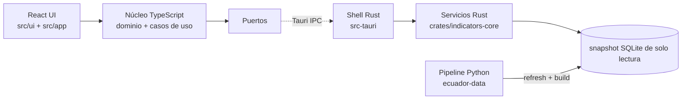

# Ecuador Indicators

[](https://github.com/Eduardo12Pacheco/ecuador-indicators-desktop/actions/workflows/ci.yml)
[](https://github.com/Eduardo12Pacheco/ecuador-indicators-desktop/releases/latest)
[](LICENSE)
[](docs/INSTALL.md)

Una aplicación de escritorio pulida y offline-first para explorar, comparar y
exportar indicadores económicos y sociales del Ecuador desde una instantánea
de datos del Banco Mundial incluida con la aplicación.

**Instalación:** lee primero la [guía de instalación](docs/INSTALL.md); las
compilaciones no están firmadas, así que Windows SmartScreen y macOS Gatekeeper
pedirán confirmación. El primer release etiquetado está pendiente; mientras
tanto, [ejecútalo desde el código fuente](#desarrollo).


## Por qué

Las estadísticas ecuatorianas están repartidas en portales con formatos y
licencias distintas. Esta aplicación incluye una instantánea reproducible del
Banco Mundial para que los datos estén disponibles sin navegador, sin API key y
sin conexión a internet.
Trata los datos como un artefacto editorial: con fuente, atribución,
verificación y honestidad sobre los años que faltan.

## Funcionalidades

- **Explorar** 38 indicadores WDI en 8 temas, con pares, rangos de años,
  transformaciones Level/YoY/Index, gráficos de línea/área/barra y una tabla de
  datos alternativa.
- **Comparar** trayectorias de indicadores indexadas a un año base, y un ranking
  entre países con Ecuador resaltado y los valores faltantes al final.
- **Buscar** indicadores, geografías, vistas y comandos con `Mod+K`, sin
  distinguir diacríticos en inglés y español, además de atajos de teclado.
- **Vistas guardadas** que restauran el estado exacto de la página, se renombran
  y se eliminan.
- **Exportar** CSV (RFC 4180) y PNG a 2× con título, leyenda y atribución.
- **Ajustes** de tema, idioma, comprobación opcional de actualizaciones e
  instantáneas personalizadas.
- **Accesible**: gráficos con teclado, flujos completos sin ratón, escaneos axe
  WCAG 2.0/2.1 AA, temas claro y oscuro, interfaz completa en inglés y español.

## Capturas

| Explorar | Comparar | Datos y Acerca de |
|---|---|---|
|  |  |  |

El conjunto completo, incluidos el modo oscuro, el español y la paleta de
comandos, está en `docs/media/screenshots/`. Se capturan desde el frontend real
con el comando versionado `npm run capture:media`.

## Instalación

```bash
# Linux (Debian/Ubuntu)
sudo apt install ./ecuador-indicators_0.1.0_linux_x64.deb
# macOS (Apple Silicon)
open ecuador-indicators_0.1.0_macos_arm64.dmg
# Windows
# Ejecuta ecuador-indicators_0.1.0_windows_x64.exe
```

Las alternativas AppImage, RPM, DMG para Intel y MSI, los comandos de checksum,
`gh attestation verify` y la explicación de las compilaciones sin firma están en
[la guía de instalación](docs/INSTALL.md).

## Datos

La instantánea incluida republica 38 indicadores del World Development
Indicators del Banco Mundial (WDI, source id 2) para Ecuador, Colombia, Perú,
Chile, Bolivia, América Latina y el Caribe y el Mundo. WDI tiene licencia
CC BY 4.0; cada indicador acredita a su proveedor subyacente y la aplicación
muestra la atribución y la fecha de obtención. Consulta
[docs/DATA.md](docs/DATA.md) para el esquema, el linaje y las limitaciones.

```bash
cd pipeline && uv sync --frozen
uv run ecuador-data refresh   # red: World Bank API -> data/raw + MANIFEST.json
uv run ecuador-data build     # offline: caché raw -> snapshot schema v1
uv run ecuador-data verify    # checksums, conteos, hashes lógico y de archivo
```

Dos builds de la misma caché raw producen el mismo `logical_sha256`.

## Arquitectura



Tres runtimes y un solo contrato: un dominio TypeScript puro, un núcleo Rust
deliberadamente delgado y un pipeline Python que nunca entra al runtime de
escritorio. Las capas hexagonales se verifican con tests en los tres lenguajes;
consulta [docs/ARCHITECTURE.md](docs/ARCHITECTURE.md) para las reglas, puertos,
patrones y el modelo de errores.

## Stack técnico

| Área | Elección |
|---|---|
| Shell de escritorio | Tauri 2 (Rust), NSIS/MSI, DMG, DEB/RPM/AppImage |
| UI | React 19, TypeScript 7, Vite 8, react-router 7, TanStack Query 5 |
| Gráficos | Apache ECharts 6, tree-shaken, tabla alternativa accesible |
| Estilos | CSS Modules + tokens en custom properties, primitivas Radix, cmdk |
| Pipeline de datos | Python 3.12, uv, pydantic, httpx, Typer, SQLite, DuckDB (opcional) |
| Tests | Vitest + Testing Library + fast-check, Playwright + axe, cargo test + proptest, pytest + Hypothesis |
| CI/CD | GitHub Actions en Linux, Windows y macOS; releases disparados por tag |

## Calidad

| Puerta | Valor medido |
|---|---|
| Cobertura TypeScript | 91.7% líneas · 83.87% ramas · 91.67% sentencias · 91.56% funciones |
| Cobertura del pipeline Python | 96.1% |
| E2E de navegador | 68 escenarios (proyectos Chromium + WebKit) |
| Cobertura de líneas del núcleo Rust | 88.9% medido en la ejecución de CI 44749667530 (puerta: 85%, `cargo llvm-cov`) |
| Total gzip de JavaScript | 392,397 B |
| Instantánea incluida | 38 indicadores · 8 temas · 7 geografías · 11,780 observaciones |

`npm run metrics` imprime cada valor anterior salvo el de Rust, que sale de
`cargo llvm-cov -p indicators-core`. El presupuesto gzip es 716,800 B y la suite
E2E nativa corre en Linux dentro de CI.

## Desarrollo

```bash
npm ci
npm run tauri dev
npm run verify
```

`npm run verify` ejecuta Biome, `tsc`, cobertura de Vitest, formato/clippy/tests
de Rust, la suite Python, el drift de bindings, la verificación de datos, la
sincronización de versión, el build de producción, el presupuesto del bundle,
la revisión de licencias y los dos proyectos de Playwright. Consulta
[docs/TESTING.md](docs/TESTING.md) para los ciclos más rápidos.

## Limitaciones

- Solo datos anuales del Banco Mundial; muchas series tienen rezagos de varios
  años y algunas son estimaciones modeladas, así que el último año disponible
  cambia según el indicador.
- No es un producto oficial de estadísticas del BCE ni del INEC y no pretende
  serlo. Esas fuentes están documentadas como adaptadores futuros, no incluidas.
- Los instaladores no están firmados ni notarizados: Windows SmartScreen y macOS
  Gatekeeper exigen una aprobación explícita. Cada release publica checksums y
  atestaciones de procedencia.
- El E2E nativo cubre solo Linux porque `tauri-driver` no tiene driver para
  WKWebView en macOS; los mismos flujos corren en WebKit y Chromium en la suite
  de navegador.
- Las capturas y el GIF se generan con Playwright contra el frontend de
  producción usando la instantánea completa a través del adaptador en memoria.

## Documentación

[Arquitectura](docs/ARCHITECTURE.md) · [Configuración](docs/ARCHITECTURE.md#configuration) ·
[Datos](docs/DATA.md) · [Diseño](docs/DESIGN.md) · [Tests](docs/TESTING.md) ·
[Instalación](docs/INSTALL.md) · [Publicación](docs/RELEASING.md) ·
[Manifiesto lakehouse](docs/LAKEHOUSE-MANIFEST.md) ·
[Contribuir](CONTRIBUTING.md) · [Seguridad](SECURITY.md) ·
[Avisos de terceros](THIRD_PARTY_NOTICES.md)

## Licencia

MIT © 2026 Eduardo Pacheco. Los datos del Banco Mundial incluidos son CC BY 4.0;
consulta [THIRD_PARTY_NOTICES.md](THIRD_PARTY_NOTICES.md).
