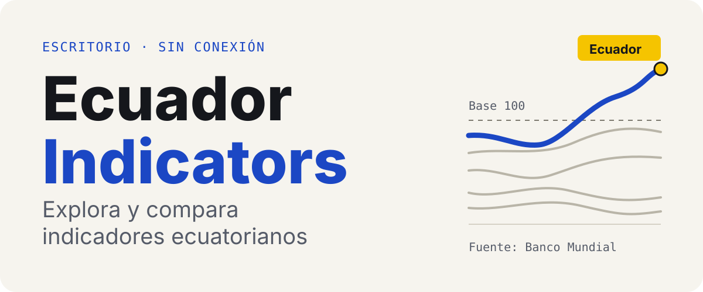
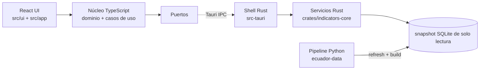

<p align="center">
  
</p>

<p align="center">
  Explora, compara y exporta indicadores de Ecuador desde una instantánea offline del Banco Mundial.<br>
  <b>Español</b> · <a href="README.en.md">English</a>
</p>

<p align="center">
  <a href="https://github.com/Eduardo12Pacheco/indicadores-ecuador-escritorio/actions/workflows/ci.yml"></a>
  <a href="https://github.com/Eduardo12Pacheco/indicadores-ecuador-escritorio/releases/latest"></a>
  <a href="LICENSE"></a>
</p>

<p align="center">
  
</p>

## Qué es

Ecuador Indicators es una aplicación de escritorio (Tauri 2, React y Rust) para explorar y comparar 38 indicadores del World Development Indicators del Banco Mundial para Ecuador, Colombia, Perú, Chile, Bolivia, América Latina y el Caribe y el Mundo. Funciona sin navegador, sin API key y sin conexión a internet.

- **Explorar**: 38 indicadores en 8 temas, con pares, rangos de años, transformaciones Level/YoY/Index y una tabla de datos alternativa.
- **Comparar**: trayectorias indexadas a un año base, o un ranking entre países con Ecuador resaltado.
- **Exportar**: CSV (RFC 4180) y PNG a 2× con título, leyenda y atribución.
- **Accesible**: flujos pensados para teclado, escaneos axe WCAG 2.0/2.1 AA, temas claro y oscuro, interfaz en español e inglés.

| Explorar | Comparar | Datos y Acerca de |
|---|---|---|
|  |  |  |

## Por qué es distinto

Las estadísticas ecuatorianas están repartidas en portales con formatos y licencias distintas. Esta app parte de un único artefacto reproducible:

- **Instantánea verificable**: la base SQLite se construye desde una caché cruda con checksums; dos builds de la misma caché producen el mismo `logical_sha256`.
- **Atribución en cada salida**: WDI tiene licencia CC BY 4.0 y cada indicador acredita a su proveedor; la exportación PNG incluye la atribución.
- **Arquitectura comprobable**: un dominio TypeScript puro, un núcleo Rust delgado y un pipeline Python que nunca entra en el runtime de escritorio. Las reglas hexagonales se prueban en los tres lenguajes.

## Cómo funciona



La UI nunca toca SQLite: habla con Rust por IPC tipado. Para regenerar la instantánea desde el Banco Mundial:

```bash
cd pipeline && uv sync --frozen
uv run ecuador-data refresh   # red: API del Banco Mundial -> data/raw + MANIFEST.json
uv run ecuador-data build     # sin conexión: caché raw -> snapshot schema v1
uv run ecuador-data verify    # checksums, conteos, hashes lógico y de archivo
```

Esquema, linaje y limitaciones de los datos: [docs/DATA.md](docs/DATA.md). Arquitectura completa: [docs/ARCHITECTURE.md](docs/ARCHITECTURE.md).

<details>
<summary>Stack técnico</summary>

| Área | Elección |
|---|---|
| Shell de escritorio | Tauri 2 (Rust), NSIS/MSI, DMG, DEB/RPM/AppImage |
| UI | React 19, TypeScript 7, Vite 8, react-router 7, TanStack Query 5 |
| Gráficos | Apache ECharts 6, tree-shaken, tabla alternativa accesible |
| Estilos | CSS Modules + tokens en custom properties, primitivas Radix, cmdk |
| Pipeline de datos | Python 3.12, uv, pydantic, httpx, Typer, SQLite, DuckDB (opcional) |
| Pruebas | Vitest + Testing Library + fast-check, Playwright + axe, cargo test + proptest, pytest + Hypothesis |
| CI/CD | GitHub Actions en Linux, Windows y macOS; releases disparados por tag |

</details>

## Inicio rápido

Requisitos: Node.js 24 o superior (26 recomendado), Rust stable 1.95 o superior y [uv](https://docs.astral.sh/uv/) 0.11 o superior. En Linux, instala antes los paquetes de Tauri listados en [CONTRIBUTING.md](CONTRIBUTING.md#requisitos-previos).

```bash
git clone https://github.com/Eduardo12Pacheco/indicadores-ecuador-escritorio.git
cd indicadores-ecuador-escritorio
npm ci
npm run tauri dev     # abre la app en modo desarrollo
npm run verify        # lint, tipos, pruebas, Rust, Python, datos, build y E2E
```

En Windows se usan los mismos comandos desde PowerShell.

Todavía no hay un release etiquetado. Cuando exista, los instaladores se descargan desde la página de releases y tendrán estos nombres:

```bash
sudo apt install ./ecuador-indicators_0.1.0_linux_x64.deb  # Linux (Debian/Ubuntu)
open ecuador-indicators_0.1.0_macos_arm64.dmg               # macOS (Apple Silicon)
# Windows: ejecuta ecuador-indicators_0.1.0_windows_x64.exe
```

Otros formatos, checksums y `gh attestation verify` están en [docs/INSTALL.md](docs/INSTALL.md).

## Resultados

| Puerta | Valor medido |
|---|---|
| Cobertura TypeScript | 91.7% líneas · 83.87% ramas · 91.67% sentencias · 91.56% funciones |
| Cobertura del pipeline Python | 96.1% |
| E2E de navegador | 68 escenarios (proyectos Chromium + WebKit) |
| Cobertura de líneas del núcleo Rust | 88.9% medido en la ejecución de CI 44749667530 (puerta: 85%, `cargo llvm-cov`) |
| Total gzip de JavaScript | 392,397 B |
| Instantánea incluida | 38 indicadores · 8 temas · 7 geografías · 11,780 observaciones |

`npm run metrics` imprime cada valor anterior salvo el de Rust, que sale de `cargo llvm-cov -p indicators-core`. El presupuesto gzip es 716,800 B y la suite E2E nativa corre en Linux dentro de CI.

## Limitaciones honestas

- Solo datos anuales del Banco Mundial; muchas series tienen rezagos de años y algunas son estimaciones modeladas, así que el último año disponible puede variar según el indicador.
- No es un producto oficial del BCE ni del INEC; esas fuentes están documentadas como adaptadores futuros, no incluidos.
- Aún no hay release etiquetado y los instaladores no están firmados: SmartScreen y Gatekeeper piden aprobación. Cada release publicará checksums y atestaciones de procedencia.
- El E2E nativo cubre solo Linux porque `tauri-driver` no tiene driver para WKWebView; los mismos flujos corren en WebKit y Chromium en la suite de navegador.
- Las capturas usan la instantánea completa a través del adaptador en memoria.

## Documentación

[Arquitectura](docs/ARCHITECTURE.md) · [Configuración](docs/ARCHITECTURE.md#configuración) · [Datos](docs/DATA.md) · [Diseño](docs/DESIGN.md) · [Pruebas](docs/TESTING.md) · [Instalación](docs/INSTALL.md) · [Publicación](docs/RELEASING.md) · [Manifiesto lakehouse](docs/LAKEHOUSE-MANIFEST.md) · [Contribuir](CONTRIBUTING.md) · [Seguridad](SECURITY.md) · [Avisos de terceros](THIRD_PARTY_NOTICES.md)

## Licencia

MIT © 2026 Eduardo Pacheco. Los datos del Banco Mundial incluidos son CC BY 4.0; consulta [THIRD_PARTY_NOTICES.md](THIRD_PARTY_NOTICES.md).

## Autor

Eduardo Pacheco · https://github.com/Eduardo12Pacheco
