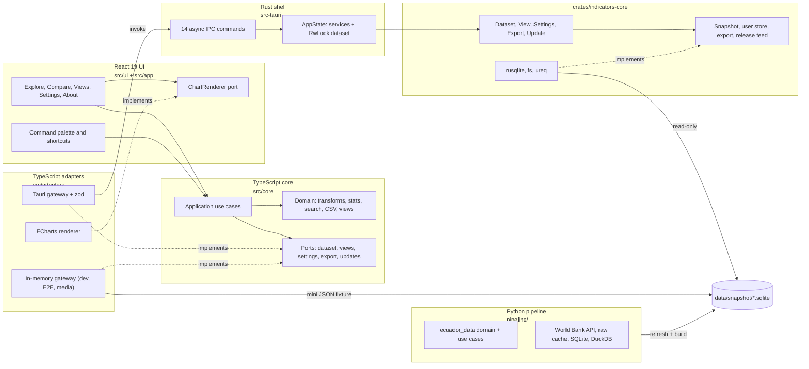
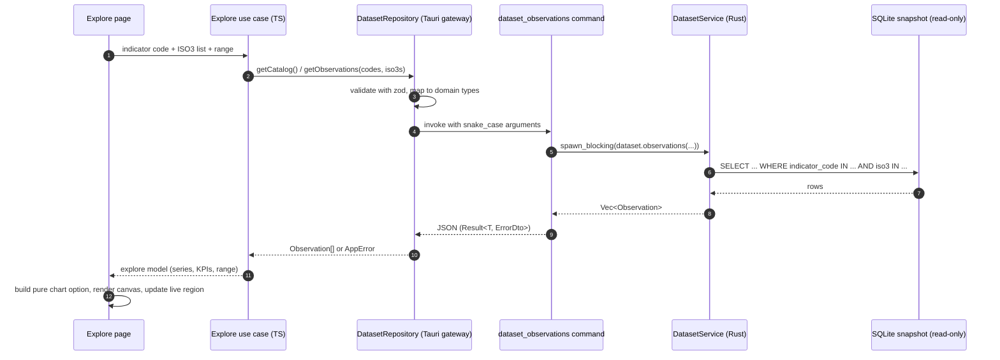
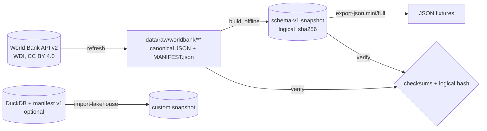

# Arquitectura

Ecuador Indicators es un solo producto construido a partir de tres runtimes que
comparten un único contrato: una instantánea SQLite tipada, un modelo de vista
etiquetado y un conjunto pequeño de códigos de error estables. La aplicación de
escritorio lee la instantánea; el pipeline de Python la crea. Nada en el runtime de
escritorio importa el pipeline.

## Panorama del sistema

La UI nunca habla con SQLite. El núcleo de Rust nunca importa Tauri. El dominio de
Python nunca importa `httpx`, `duckdb` ni `sqlite3`. Estas reglas son ejecutables
(ver [Reglas de dependencia y cómo se aplican](#reglas-de-dependencia-y-cómo-se-aplican)).

## Mapa del repositorio

| Ruta | Responsabilidad |
|---|---|
| `src/core` | TypeScript puro: tipos de dominio con marca, series/estadísticas/CSV/búsqueda, estado de vista en la URL, casos de uso y puertos. Sin imports de React, DOM, Tauri ni ECharts. |
| `src/adapters/tauri` | Gateway IPC con validación zod, mappers de wire a dominio y `.ts` de bindings versionados generados con `ts-rs`. |
| `src/adapters/memory` | Gateway de instantánea JSON sobre `localStorage`, los decoradores (`CachedDatasetRepository`, `FaultInjectingDatasetRepository`) y fixtures de prueba y de media. |
| `src/ui` | Tokens de diseño, primitivas accesibles, i18n, gráficos y páginas de funcionalidades. Solo importa tipos y casos de uso del núcleo, y librerías de presentación. |
| `src/app` | Raíz de composición: selección de adaptadores, providers, router por hash, shell y registro de atajos. |
| `crates/indicators-core` | Dominio, puertos, servicios de aplicación y adaptadores de infraestructura de Rust (SQLite, sistema de archivos, HTTP). |
| `src-tauri` | Shell de Tauri: CLI, configuración tipada, logging, estado, 14 comandos, self-check, plugins y ciclo de vida de la ventana. |
| `pipeline` | Paquete `ecuador-data` de Python 3.12: refresh, build, verify, importación lakehouse y exportación JSON. |
| `scripts` | Scripts de release, calidad y métricas en Node ESM multiplataforma, cada uno cubierto por Vitest cuando el comportamiento no es trivial. |
| `e2e`, `e2e-native` | Suite de navegador con Playwright (Chromium + WebKit) y suite nativa con WebdriverIO (Linux). |

## Reglas de dependencia y cómo se aplican

| Capa | Puede importar | No debe importar | Verificado por |
|---|---|---|---|
| TS `core/domain` | sí mismo | `application`, `contracts`, `adapters`, `ui`, `app`, React, Tauri, ECharts | `src/architecture.test.ts` |
| TS `core/application` | `core/domain`, sus propios `ports` | `adapters`, `ui`, `app`, React, Tauri | `src/architecture.test.ts` |
| TS `core/contracts` | `core/domain`, `zod`, tipos de wire generados | `ui`, `app` | `src/architecture.test.ts` |
| TS `adapters/*` | `core/*`, API de Tauri, `zod` | `ui`, `app` | `src/architecture.test.ts` |
| TS `ui/*` | tipos de `core/domain`, tipos de `core/application`, `ui/*`, React, Radix, lucide, ECharts | `adapters/*`, `app/*`, bindings generados, `@tauri-apps/*` | `src/architecture.test.ts` |
| TS `app/*` | todo (raíz de composición) | no aplica | no aplica |
| Rust `domain`, `ports`, `application` | `std`, `serde`, `ts-rs`, `thiserror`, `semver`, sus propios módulos | `rusqlite`, `ureq`, `tauri`, `std::fs`, `std::net`, `std::env` | `crates/indicators-core/tests/architecture.rs` |
| Rust `adapters` | `ports`, `domain`, `rusqlite`, `ureq`, `sha2`, `std::fs` | `application` | `architecture.rs` más la aserción del grafo de dependencias |
| `src-tauri` | `indicators-core`, crates de Tauri | importaciones inversas desde el núcleo | grafo de Cargo del workspace |
| Python `domain` | stdlib, `pydantic` | `ports`, `application`, `adapters`, `httpx`, `duckdb`, `sqlite3` | import-linter |
| Python `application` | `domain`, `ports` | `adapters` | import-linter |
| Python `adapters` | `domain`, `ports`, `httpx`, `duckdb`, `sqlite3` | `application` | import-linter |

Cada prueba de arquitectura se comprobó con una violación deliberada (evidencia RED en
el registro de la tarea): un import de `rusqlite` en el dominio de Rust, `@tauri-apps/api`
en el núcleo de TypeScript y `httpx` en el dominio de Python rompen su contrato.

## Puertos y adaptadores

| Runtime | Puerto | Adaptador de producción | Adaptador de prueba o alternativo |
|---|---|---|---|
| TypeScript | `DatasetRepository` (`getInfo`, `getCatalog`, `getObservations`, `openSnapshot`, `resetSnapshot`) | `TauriGateway` | `MemoryGateway`; `CachedDatasetRepository`; `FaultInjectingDatasetRepository` |
| TypeScript | `ViewRepository`, `SettingsRepository` | `TauriGateway` | `MemoryGateway` sobre `localStorage` |
| TypeScript | `ExportGateway`, `SnapshotPicker`, `UpdateGateway`, `AppInfoGateway`, `ExternalLinkGateway` | plugins de Tauri (`dialog`, `opener`, `invoke`) | descarga en memoria / selector sin efecto |
| TypeScript (UI) | `ChartRenderer` (`setOption`, `showTip`, `hideTip`, `toDataURL`, `resize`, `dispose`) | `EchartsRenderer` | `FakeChartRenderer` |
| Rust | `SnapshotReader`, `SnapshotOpener` | `SqliteSnapshotReader`, `SqliteSnapshotOpener` | fixtures SQLite temporales |
| Rust | `UserStore` | `SqliteUserStore` | SQLite temporal real en las pruebas |
| Rust | `ExportWriter` | `FsExportWriter` | directorios temporales |
| Rust | `ReleaseFeed`, `HttpGet` | `GithubReleaseFeed` sobre `UreqHttpGet` | servidor `httpmock` + JSON grabado |
| Rust | `Clock`, `IdGenerator` | `SystemClock`, `UuidGenerator` | fakes deterministas |
| Python | `IndicatorSource` | `WorldBankApiSource` | fixtures grabados de `respx` |
| Python | `RawStore` | `FileRawStore` | directorios temporales |
| Python | `SnapshotWriter` | `SqliteSnapshotWriter` | SQLite temporal real |
| Python | `Clock` | `SystemClock` | reloj fijo |

Las definiciones de los puertos están en `src/core/application/ports.ts`,
`crates/indicators-core/src/ports.rs` y `pipeline/src/ecuador_data/ports.py`.

## Patrones usados de forma deliberada

| Patrón | Dónde | Por qué |
|---|---|---|
| Puertos y adaptadores | los tres runtimes | Mantiene la lógica del producto independiente de Tauri, SQLite, HTTP y el DOM. |
| Repositorio | `DatasetRepository`, `ViewRepository`, `SettingsRepository`; `UserStore` de Rust | Una sola API tipada para la persistencia, en lugar de comandos dispersos. |
| Estrategia | `RankingStrategy` en la búsqueda; funciones de transformación seleccionadas por `Transform` | El ranking de búsqueda y las transformaciones interanuales o de índice son intercambiables y se prueban de forma aislada. |
| Comando | `src/app/shortcuts/registry.ts` y las acciones de la paleta | Un solo registro define ids, atajos, disponibilidad y ejecución; la UI solo despacha comandos. |
| Builder | `buildChartOption`, `buildTrajectoriesOption`, `buildRankingOption` | Los objetos de opciones puros se afirman sin canvas. |
| Decorador | `CachedDatasetRepository`, `FaultInjectingDatasetRepository` | El caché y la inyección de fallas para pruebas se componen sobre el puerto real. |
| Raíz de composición | `src/app/bootstrap.ts`, `src-tauri/src/lib.rs`, `ecuador_data/cli.py` | Solo las raíces de composición conocen los adaptadores concretos. |
| Resultado / error tipado | `Result<T, AppError>` (TS), `Result<T, CoreError>` (Rust), excepciones tipadas en el borde de la CLI de Python | Los fallos siguen siendo valores hasta que un borde los traduce para el usuario. |
| Inyección de reloj e id | `Clock` e `IdGenerator` de Rust; `Clock` de Python | Las marcas de tiempo y los ids de las vistas guardadas son deterministas en las pruebas. |
| Mapeo anticorrupción | `src/adapters/tauri/mappers.ts` | Los DTO de wire (snake_case) se convierten en tipos de dominio con marca (`IndicatorCode`, `Iso3`, `Year`). |

## Abrir un indicador, de extremo a extremo

El hash de la URL es la fuente de verdad de lo que ve la persona usuaria. Las claves
de la consulta se analizan en un estado tipado de Explorar/Comparar, se sanean contra
el catálogo y se serializan de nuevo sin valores por defecto. Las vistas guardadas
almacenan el mismo estado, así que abrir una vista usa la misma ruta de código que un
enlace directo.

## Modelo de errores

Los fallos de IPC son siempre `ErrorDto {code, message}` con un código estable. La UI
asigna cada código a un mensaje traducido y, cuando es posible recuperarse, a una
acción. El núcleo de Rust es la autoridad para la validación de vistas guardadas;
TypeScript la replica para dar retroalimentación rápida.

| Código | Significado | Recuperación habitual |
|---|---|---|
| `SNAPSHOT_INVALID` | El archivo SQLite seleccionado no es una instantánea schema-v1 válida. | Conservar el conjunto de datos anterior; ofrecer restablecer la instantánea incluida. |
| `SNAPSHOT_NOT_FOUND` | La ruta configurada de la instantánea no existe. | Pantalla de problema del conjunto de datos con restablecimiento. |
| `VIEW_NOT_FOUND` | El id de la vista guardada ya no existe. | Actualizar la lista. |
| `VIEW_INVALID` | El nombre o la especificación de la vista incumplen el modelo. | Validación en línea en el diálogo de guardado. |
| `LIMIT_EXCEEDED` | Se alcanzó el límite de 200 vistas. | Eliminar una vista antigua. |
| `STORAGE` | Fallo de SQLite o del sistema de archivos en la tienda de usuario. | Reintentar; el estado de error muestra los detalles. |
| `EXPORT_REJECTED` | La ruta de exportación no es `.csv` ni `.png`, no tiene nombre de archivo o supera 50 MiB. | Elegir otra ruta o formato. |
| `UPDATE_FEED` | No se pudo interpretar el feed de releases de GitHub. | Mostrar el error y mantener la app utilizable. |
| `NETWORK` | La comprobación de actualizaciones falló en la capa de transporte. | Reintentar cuando haya conexión. |
| `INTERNAL` | Fallo inesperado (envenenamiento de un lock, error de join, bug). | Reintentar y, después, reportar. |
| `INVALID_INPUT` | Fallo de validación del lado del cliente antes de IPC. | Corregir la entrada. |

El pipeline usa, en cambio, excepciones tipadas y códigos de salida: `0` éxito, `1`
error inesperado, `2` fallo de integridad o de validación (`IntegrityError`,
`ManifestError`, `CatalogError`) y `3` fuente no disponible (`SourceUnavailableError`,
`SourceProtocolError`).

## Concurrencia y estado

- `AppState` contiene un `RwLock<Arc<DatasetService>>`; el servicio de dataset
  intercambia su `SnapshotReader` activo bajo su propio lock. Una apertura fallida deja
  intactos tanto el lector como el `Arc`, así que una instantánea personalizada inválida
  nunca reemplaza un conjunto de datos que funciona.
- Cada comando de Tauri es `async` y delega el trabajo bloqueante de SQLite y del sistema
  de archivos a `tauri::async_runtime::spawn_blocking`; el hilo del webview nunca espera
  por E/S.
- Las conexiones SQLite están protegidas por un `Mutex`. La instantánea se abre con
  `SQLITE_OPEN_READ_ONLY` y `PRAGMA query_only = ON`; la tienda de usuario habilita WAL y
  ejecuta `rusqlite_migration` una sola vez.
- Las exportaciones se escriben en un archivo temporal dentro del directorio de destino y
  luego se renombran a su nombre final; en Windows, el destino se reemplaza de forma
  explícita.
- La comprobación de actualizaciones es optativa, se limita a una comprobación cada 24
  horas al iniciar y nunca descarga ni instala nada. `ReleaseFeed` es el único puerto de
  red.

## Configuración

Ambos runtimes usan configuración tipada. El escritorio lee `ECUADOR_INDICATORS_*` a
través de `src-tauri/src/config.rs`; el pipeline lee `ECUADOR_DATA_*` a través de
`pipeline/src/ecuador_data/settings.py` (pydantic-settings, prefijo `ECUADOR_DATA_`).
Los valores desconocidos recurren a los valores por defecto documentados en lugar de
hacer fallar la app.

| Variable | Valor por defecto | Propósito |
|---|---|---|
| `ECUADOR_INDICATORS_HOME` | directorio de datos de la app de la plataforma | Cambia dónde viven `user.db` y los ajustes. |
| `ECUADOR_INDICATORS_LOG` | `info` | Filtro de tracing o nivel de log; los archivos rotativos quedan en el directorio de logs de la plataforma. |
| `ECUADOR_INDICATORS_SNAPSHOT` | recurso incluido | Abre una instantánea concreta al iniciar; tiene prioridad sobre la ruta personalizada recordada. |
| `ECUADOR_INDICATORS_UPDATE_URL` | API de la última release de GitHub | Cambia el feed de releases; lo usan las pruebas y los espejos sin conexión. |
| `ECUADOR_DATA_DATA_DIR` | `data/` del repositorio (o `./data` para un wheel instalado) | Raíz de la caché raw, el manifiesto y la instantánea. |
| `ECUADOR_DATA_HTTP_TIMEOUT_S` | `30` | Tiempo de espera por solicitud del adaptador del Banco Mundial. |
| `ECUADOR_DATA_HTTP_RETRIES` | `4` | Intentos antes de `SourceUnavailableError`. |
| `ECUADOR_DATA_USER_AGENT` | `ecuador-data/<version>` | User-Agent descriptivo enviado a la API. |
| `ECUADOR_DATA_LOG_LEVEL` | `info` | Nivel de structlog para el pipeline. |

Los mismos valores aparecen en `docs/INSTALL.md` (rutas del escritorio) y en
`pipeline/README.md` (uso del pipeline); `src-tauri/src/config.rs` y
`pipeline/tests/unit/test_settings.py` mantienen los valores por defecto bajo prueba.

## Pipeline de datos

`data/MANIFEST.json` registra cada archivo raw (URL, hora de obtención, tamaño en bytes,
SHA-256), el campo `lastupdated` de la fuente, el hash del archivo de la instantánea y el
hash lógico del contenido. `verify` recalcula ambos hashes y falla con código de salida 2,
indicando el archivo y los valores esperado y real. Consulta [DATA.md](DATA.md) para el
esquema, las licencias y las limitaciones, y
[LAKEHOUSE-MANIFEST.md](LAKEHOUSE-MANIFEST.md) para la importación opcional desde DuckDB.

## Cómo agregar un indicador

1. Agrega el código, el tema, `value_kind`, los decimales, `higher_is` y ambas etiquetas
   de unidad a `pipeline/catalog/indicators.toml` (los temas viven en el mismo archivo).
2. Ejecuta `cd pipeline && uv run ecuador-data refresh` (red) y versiona los archivos raw
   nuevos más `data/MANIFEST.json`; luego `uv run ecuador-data build` y
   `uv run ecuador-data verify`.
3. Regenera los fixtures JSON:
   `uv run ecuador-data export-json --subset mini --out ../src/adapters/memory/fixtures/mini.snapshot.json`;
   el fixture de la instantánea completa que usa la captura de media se construye con
   `node scripts/prepare-web-fixture.mjs full`.
4. No hacen falta cambios en TypeScript ni en Rust: el catálogo, las observaciones, las
   traducciones y las unidades provienen todos de la instantánea. Agrega una prueba solo si
   el indicador expone un `value_kind` nuevo o una regla de formato nueva.
5. Ejecuta `npm run verify` y versiona juntos los cambios de catálogo, datos y fixtures.

## Cómo agregar un adaptador de fuente de datos

1. Implementa el puerto `IndicatorSource` y/o `RawStore` de Python en
   `pipeline/src/ecuador_data/adapters/`. El adaptador puede importar el SDK o el cliente
   HTTP; las capas de dominio y de aplicación no pueden.
2. Traduce los fallos upstream a `SourceUnavailableError` o `SourceProtocolError` para que
   la CLI mantenga sus códigos de salida documentados.
3. Agrega fixtures de `respx` (o archivos grabados) y pruebas para la paginación, los
   reintentos, los valores nulos, los metadatos bilingües y los sobres de error. Ninguna
   prueba puede tocar la red.
4. Documenta la fuente, la evidencia de licencia, los checksums y la atribución en
   [DATA.md](DATA.md), y agrega una fila a `data/MANIFEST.json` cuando forme parte del build
   incluido.
5. Si la fuente es opcional, mantenla detrás de un flag de la CLI o de un comando separado,
   y nunca la importes desde el runtime de escritorio (ver ADR 0009 como precedente del
   lakehouse).

## Probar la arquitectura

| Comando | Contrato |
|---|---|
| `npx vitest run src/architecture.test.ts` | Grafo de imports de TypeScript y reglas de globales del navegador |
| `cargo test -p indicators-core --test architecture` | Tokens prohibidos de Rust y grafo de dependencias de Cargo |
| `uv run --directory pipeline lint-imports` | Capas hexagonales de Python e imports de infraestructura |
| `npm run check:bindings` | La salida de `ts-rs` coincide con los bindings de TypeScript versionados |

Las pruebas son intencionalmente simples (expresiones regulares y listas de
dependencias), porque un contrato sencillo que falla de forma ruidosa aporta más valor
aquí que un análisis estático ingenioso que puede omitirse.

## Lecturas adicionales

- [ADR 0003](adr/0003-hexagonal-architecture-across-runtimes.md): arquitectura hexagonal y
  la compensación de los DTO de wire.
- [ADR 0004](adr/0004-ipc-contract-and-typed-bindings.md): los 14 comandos IPC y los
  bindings generados.
- [ADR 0005](adr/0005-ui-system-tokens-and-primitives.md): tokens y primitivas de
  accesibilidad.
- [ADR 0006](adr/0006-charting-and-chart-accessibility.md): ECharts y la alternativa de
  accesibilidad de los gráficos.
- [ADR 0007](adr/0007-testing-strategy.md): estrategia de E2E en navegador.
- [Guía de datos](DATA.md) · [Sistema de diseño](DESIGN.md) · [Pruebas](TESTING.md) ·
  [Instalación](INSTALL.md) · [Publicación](RELEASING.md).
