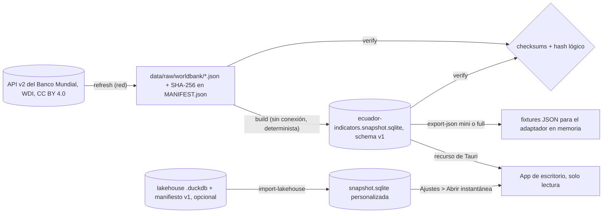

# Guía de datos

Ecuador Indicators es una aplicación offline-first que vuelve a publicar un subconjunto
incluido de los World Development Indicators (WDI) del Banco Mundial. No es un producto
oficial de estadísticas y no pretende serlo.

## Fuente y licencia

| Elemento | Valor |
|---|---|
| Fuente | Banco Mundial, World Development Indicators (WDI), source id 2 |
| API | `https://api.worldbank.org/v2` (sin clave) |
| Página del dataset | <https://datacatalog.worldbank.org/search/dataset/0037712/world-development-indicators> |
| Licencia | CC BY 4.0, <https://creativecommons.org/licenses/by/4.0/> |
| Términos | <https://datacatalog.worldbank.org/public-licenses> |
| Obtención | `path` / `url` / `sha256` por archivo en `data/MANIFEST.json` |
| Cobertura | Observaciones anuales de 1960 a 2026 (el rango de la API), siete geografías |
| Indicadores | 38, seleccionados en `pipeline/catalog/indicators.toml`, en 8 temas |
| Geografías | ECU, COL, PER, CHL, BOL, América Latina y el Caribe (LCN), Mundo (WLD) |

El texto completo de la atribución se almacena en la instantánea (`meta.attribution_en` y
`meta.attribution_es`) y se muestra en la aplicación. Los proveedores subyacentes, como
ILO, UNESCO, WHO, FAO, UNODC, ITU, IMF, UN y el propio Banco Mundial, se acreditan por
indicador mediante `source_org_en` / `source_org_es`. Consulta
[`THIRD_PARTY_NOTICES.md`](../THIRD_PARTY_NOTICES.md).

La instantánea incluida son datos generados. Nunca edites `data/raw/**` ni el archivo
SQLite a mano: actualízala o reconstrúyela con los comandos de abajo.

## Instantánea incluida

`data/snapshot/ecuador-indicators.snapshot.sqlite` es una base de datos SQLite con esquema
versión 1 (`PRAGMA user_version = 1`). El DDL exacto está en
`pipeline/src/ecuador_data/adapters/sqlite_snapshot.py`:

| Tabla | Contenido |
|---|---|
| `meta` | Procedencia: esquema, dataset, origen, fuente, fecha de obtención, licencia, atribución, versión del pipeline, hash lógico |
| `topic` | 8 temas seleccionados, con nombres en inglés y español, y orden de presentación |
| `geography` | 7 geografías con códigos ISO, nombres bilingües y marca de agregado |
| `indicator` | 38 indicadores con nombres y descripciones bilingües, organizaciones de origen, etiquetas de unidad, `value_kind`, decimales, `higher_is`, tema y orden |
| `observation` | Una fila por indicador, geografía y año, con un valor `REAL` finito |

Claves obligatorias de `meta`: `schema_version`, `dataset_id`, `dataset_version`, `origin`
(`worldbank` o `lakehouse`), `source_name`, `source_publisher`, `source_last_updated`,
`retrieved_at`, `license`, `license_url`, `attribution_en`, `attribution_es`,
`pipeline_version`, `logical_sha256`.

### Modelo de integridad

- Cada archivo raw es JSON canónico (`sort_keys`, separadores compactos, UTF-8, salto de
  línea final) registrado en `data/MANIFEST.json` con su URL, su tamaño en bytes y su
  SHA-256.
- `meta.logical_sha256` calcula el hash de un volcado de texto canónico de todas las tablas
  excepto el propio hash, en el orden de tablas `topic, geography, indicator, observation,
  meta`, con filas ordenadas por clave primaria. Dos builds de la misma caché raw producen el
  mismo hash lógico, sin importar el orden de las filas de entrada ni la disposición de las
  páginas de SQLite.
- `data/MANIFEST.json` también registra el SHA-256 de los bytes del archivo de la instantánea,
  para que el archivo distribuido pueda compararse con el manifiesto versionado.
- `verify` revisa los checksums raw, el hash del archivo de la instantánea, el esquema, los
  conteos y el hash lógico recalculado; termina con código `2` ante cualquier discrepancia.

## Linaje



## Reproducir el dataset

Requisitos: Python 3.12 y uv (el pipeline los fija en `pipeline/pyproject.toml` y en
`.python-version`). Ejecuta los comandos desde `pipeline/`, salvo que un comando indique
lo contrario. El directorio de datos por defecto es `data/` del repositorio; cámbialo con
`ECUADOR_DATA_DATA_DIR`.

```bash
cd pipeline
uv sync --frozen

# 1. Obtener metadatos en inglés y español, además de las observaciones (red).
uv run ecuador-data refresh

# 2. Construir la instantánea determinista y actualizar data/MANIFEST.json.
uv run ecuador-data build

# 3. Verificar checksums raw, esquema de la instantánea, conteos y ambos hashes.
uv run ecuador-data verify
```

`build` funciona sin conexión. Dos ejecuciones desde la misma caché raw imprimen el mismo
`logical_sha256`; el CI lo compara con el manifiesto y reconstruye los fixtures mini.

### Subconjunto mini

`pipeline/catalog/mini.toml` selecciona seis indicadores y cinco geografías. Alimenta el
fixture de contrato de Rust y el fixture del adaptador en memoria:

```bash
cd pipeline
uv run ecuador-data build --subset mini --out ../crates/indicators-core/tests/fixtures/mini.snapshot.sqlite
uv run ecuador-data export-json --subset mini --out ../src/adapters/memory/fixtures/mini.snapshot.json
```

`export-json` ejecuta el mismo build determinista en un directorio temporal y escribe JSON
canónico:
`{"schema_version":1,"meta":{...},"topics":[...],"geographies":[...],"indicators":[...],"observations":[[code,iso3,year,value],...]}`
con las tablas ordenadas por clave primaria. El comando es reproducible byte a byte.

### Importación desde lakehouse (opcional)

```bash
cd pipeline
uv sync --extra lakehouse
uv run ecuador-data import-lakehouse --manifest ../sibling/manifest.json --out ../data/from-lakehouse.sqlite
```

El archivo DuckDB se abre en modo solo lectura y nunca se enlaza en el runtime de
escritorio. El contrato, el ejemplo y la tabla de errores están en
[`LAKEHOUSE-MANIFEST.md`](LAKEHOUSE-MANIFEST.md).

## Inspeccionar una instantánea

```bash
sqlite3 data/snapshot/ecuador-indicators.snapshot.sqlite \
  "PRAGMA user_version; SELECT value FROM meta WHERE key='license';"
sqlite3 data/snapshot/ecuador-indicators.snapshot.sqlite \
  "SELECT COUNT(*) FROM observation; SELECT COUNT(*) FROM indicator;"
jq '.snapshot.counts' data/MANIFEST.json
```

## Política de checksums

- `data/MANIFEST.json` es la autoridad para la caché raw y la instantánea incluida. Una
  actualización lo regenera; revisa el diff antes de versionarlo.
- Los archivos raw nunca se editan: si un archivo cambia, o se vuelve a obtener o el
  manifiesto está mal. `verify` indica el archivo y los valores esperado y real.
- El self-check del escritorio compara los bytes de la instantánea incluida con el manifiesto
  incluido. El hash lógico no se recalcula en Rust.
- Los instaladores de release se publican con `SHA256SUMS.txt` y una atestación de
  procedencia del build; consulta `docs/INSTALL.md` (tarea de release).

## Limitaciones

- **Solo datos anuales.** Las series de WDI son anuales; la aplicación no incluye series
  mensuales ni trimestrales.
- **Rezagos de reporte.** Distintas series terminan en distintos años (por ejemplo, la
  mortalidad materna llega hasta 2023, la alfabetización hasta 2024 y el PIB hasta 2025). Los
  valores faltantes son huecos, nunca cero.
- **Estimaciones y modelos.** Varios indicadores son estimaciones modeladas (series laborales
  de la OIT, series de mortalidad y salud de la OMS y la ONU, proyecciones de población de la
  ONU, estimaciones de pobreza del Banco Mundial). No son conteos de encuestas en bruto.
- **Sin afirmación de estadística oficial.** La aplicación vuelve a publicar WDI y lo indica;
  no es un producto oficial del BCE ni del INEC.
- **BCE e INEC no están incluidos.** El BCE no declara una licencia para sus datos
  estadísticos, y el pie con CC BY 4.0 del INEC no cubre con claridad los conjuntos de datos
  enlazados; ninguno de los dos tiene un endpoint estable y verificado legible por máquina.
  Solo podrían ser candidatos para un futuro adaptador de `IndicatorSource` después de una
  autorización por escrito.
- **Agregados.** LCN y WLD son agregados del Banco Mundial, no países. Sus series de pobreza
  y de Gini no existen donde el Banco Mundial no publica valores agregados.
- **Metadatos en español** provienen de la API en español del Banco Mundial; los valores
  derivados los calcula la aplicación y no son cálculos oficiales del Banco Mundial.
- **Nombres sin modificar.** La API devuelve algunos nombres de geografía con espacios al
  final (por ejemplo, `LCN`). La caché raw y la instantánea los conservan tal cual para que los
  checksums sigan siendo reproducibles; la UI los recorta al mostrarlos.
